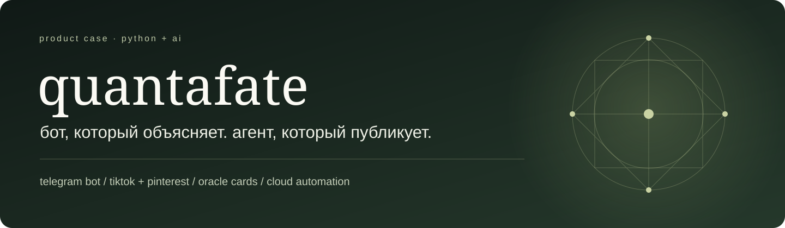
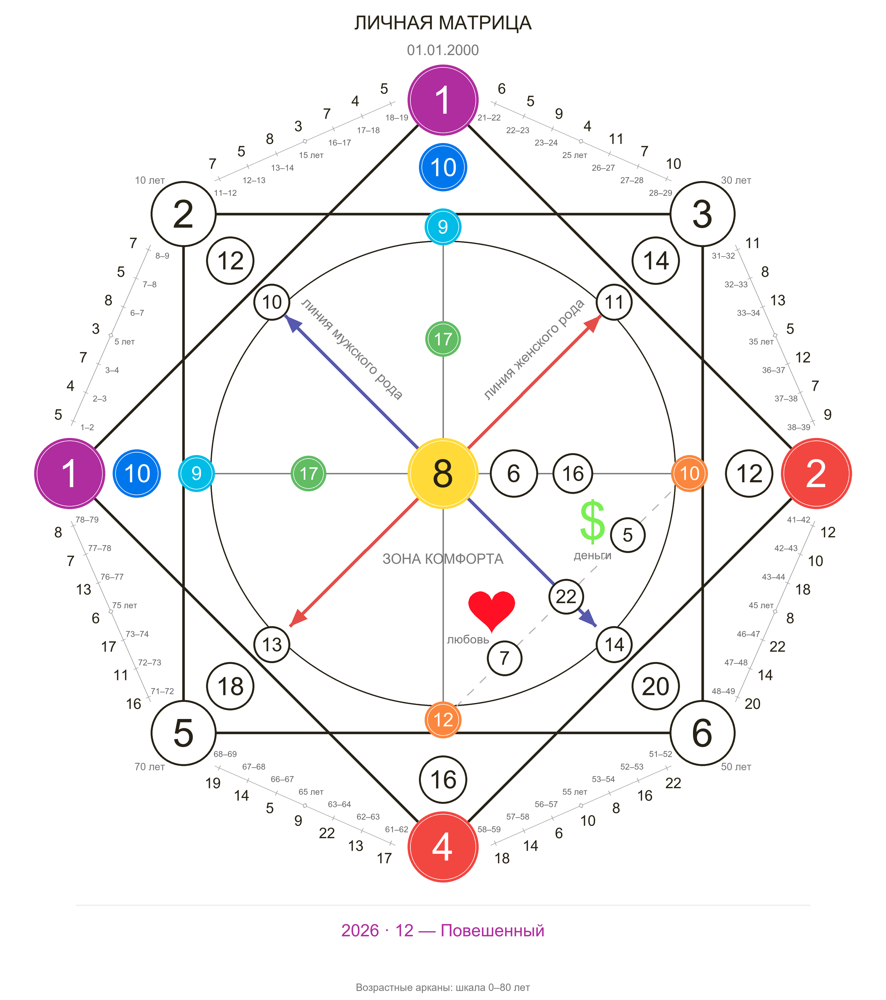
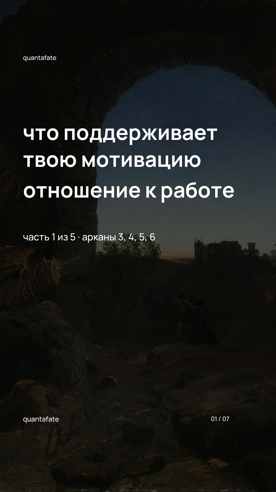
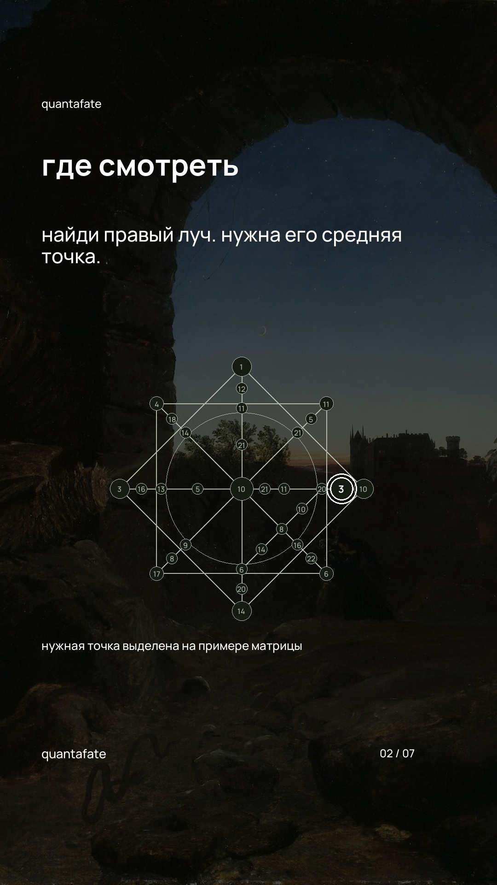
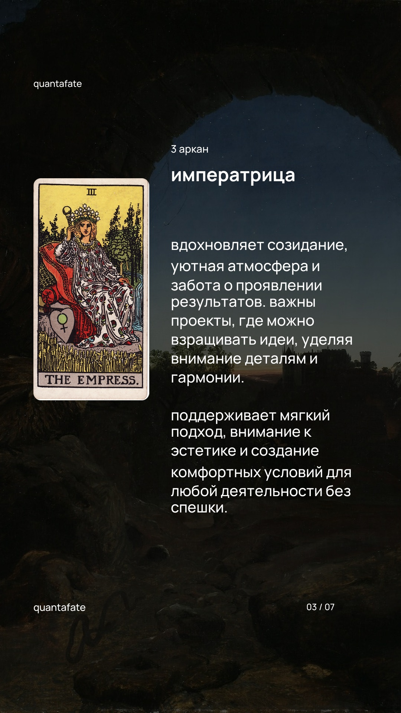
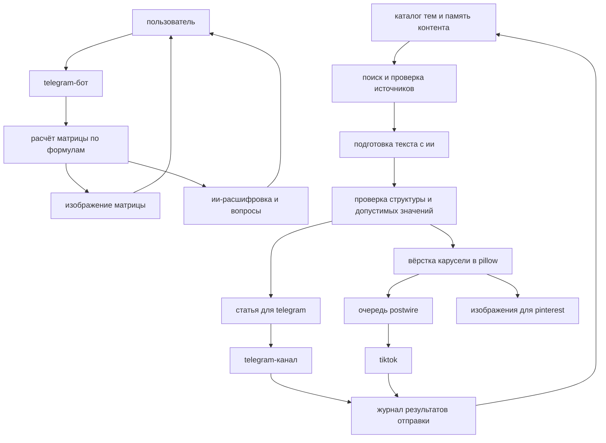

<p align="center">
  
</p>

<p align="center">
  <a href="https://github.com/mrgrtglcht/quantafate-agent/actions/workflows/verify.yml"></a>
  
  
  
  
</p>

<p align="center">
  <a href="https://t.me/quantafate_bot"><b>открыть бота ↗</b></a> ·
  <a href="https://t.me/quantafate"><b>telegram-канал ↗</b></a> ·
  <a href="https://www.tiktok.com/@quanta.aura"><b>tiktok ↗</b></a>
</p>

# от личной матрицы до контента в соцсетях

**quantafate — проект, который объединяет telegram-бота с расчётом матрицы судьбы и ии-расшифровкой, образовательный telegram-канал и агента для создания и публикации каруселей в tiktok.**

пользователь получает персональную схему и может задавать вопросы о ней. контент-агент помогает развивать проект: продолжает тематические серии, готовит тексты и изображения, сохраняет историю и отправляет материалы по расписанию.

> этот репозиторий содержит контент-агента и интеграции публикации. telegram-бот — отдельный компонент проекта; ниже показаны его возможности и связь с общей системой.

## 01 / telegram-бот: расчёт, изображение, диалог

сценарий начинается с `/start`: пользователь выбирает **личную матрицу** или **совместимость двух людей**, затем вводит одну или две даты рождения.

бот проверяет даты, вычисляет матрицу и отправляет её изображение. дальше пользователь задаёт вопрос обычным текстом: например, о центральном аркане, талантах, отношениях или выбранном годе. ии получает рассчитанные значения и контекст диалога, чтобы объяснить нужную часть матрицы.

| возможность | как реализовано |
| --- | --- |
| личная матрица | расчёт по дате рождения, 32 основные точки, родовые линии, зоны любви и денег |
| совместимость | расчёт двух личных матриц и общей схемы пары |
| визуализация | png 2800 × 3160 с цветными узлами, связями и возрастными значениями по контуру |
| расшифровка | ответы gemini на свободные вопросы по уже рассчитанным данным |
| работа с годами | отдельный календарный аркан и выбор года через `/year` |
| память диалога | sqlite сохраняет состояние, активную матрицу и историю последних вопросов |
| управление данными | повторный показ схемы, изменение даты, отмена ввода и удаление своих данных |

**числа считает код; ии отвечает за объяснение.** расчёт матрицы и генерация текста разделены, чтобы модель не подменяла формулы произвольными значениями.

<p align="center">
  
  <br><sub>реальный результат рендера бота · условная дата 01.01.2000, не данные пользователя</sub>
</p>

## 02 / telegram-канал: подробные тематические серии

канал дополняет бота понятными разборами. структура серии идёт от общего к частному: сначала материал о позиции в матрице, затем отдельные публикации о допустимых для неё арканах.

агент подбирает следующую тему, читает источники и готовит подробный текст в заданном авторском стиле: **строчные буквы, обращение на «ты», короткие абзацы и спокойный тон**. тематические изображения добавляются выборочно. реклама бота не вставляется в каждый пост.

темы охватывают центр матрицы, таланты, отношения, профессиональные направления и значения арканов. история telegram ведётся отдельно от tiktok: публикация карусели не считается публикацией статьи.

## 03 / tiktok: от темы до готовой карусели

одна карусель — семь вертикальных слайдов: обложка, схема с нужной позицией, содержательный разбор и финал по выбранному шаблону.

| дизайн | автоматизация |
| --- | --- |
| формат 1080 × 1920 | программа кадрирует фоны и проверяет размеры |
| белый текст и кириллический manrope | переносы строк, подбор размера шрифта и проверка границ |
| атмосферные затемнённые фоны | журнал источников и визуальных хешей помогает исключать повторы |
| карты старших арканов в тематических сериях | нужные изображения выбираются по номеру аркана |
| единый стиль всей карусели | новая часть получает собственный фон |
| короткие описания | публикация через postwire с автодобавлением музыки tiktok |

<table>
  <tr>
    <td align="center"><br><sub>обложка</sub></td>
    <td align="center"><br><sub>где смотреть</sub></td>
    <td align="center"><br><sub>разбор аркана</sub></td>
  </tr>
</table>

*примеры из подготовленной серии. музыка подбирается tiktok при отправке; это не обещание конкретного трека или охватов.*

для **pinterest** предусмотрена отдельная вёрстка **1000 × 1500**: изображения адаптируются под композицию 2:3. подготовка этих материалов реализована; автоматическая публикация многокарточных пинов не заявляется.

## 04 / как всё связано



**бот и контент используют общую предметную логику, но решают разные задачи.** пользовательские диалоги бота не служат источником идей для публичных постов: контент строится по каталогу тем и открытым источникам.

контент-агент запускается в **github actions**, поэтому компьютер владельца не должен оставаться включённым. telegram-бот работает как отдельный сервис; для него подготовлены docker и systemd-конфигурация.

## 05 / что делает проект инженерным кейсом

- **предметные ограничения в коде.** формулы и допустимые значения проверяются до публикации; модель не может самостоятельно назначить любой аркан любой позиции.
- **память вместо бесконечного «сгенерируй ещё».** журнал хранит темы, части серий, использованные фоны и отправки. смена заголовка или размера картинки не создаёт новую тему.
- **восстановление после сбоев.** промежуточные результаты сохраняются; подготовку можно продолжить без повторного запроса к модели. неизвестный результат отправки останавливает автоматическое повторение.
- **проверяемые источники.** сохраняются ссылки, даты проверки и контрольные суммы. для публикаций используются подготовленные материалы с проверенными условиями использования.
- **контроль доставки.** «поставлено в очередь» и «опубликовано» — разные состояния; серия продолжается с учётом журнала.
- **контроль качества.** тесты покрывают расчётные ограничения, порядок частей, память, вёрстку и поведение интеграций при ошибках.

## технологии

| слой | инструменты |
| --- | --- |
| telegram-бот, отдельный компонент | python, aiogram 3, aiosqlite, httpx, gemini |
| расчёты и графика | python, pillow, шрифты с кириллицей |
| контент-агент в этом репозитории | gemini, каталоги позиций и тем, чтение источников, json-журналы |
| публикация | telegram bot api, postwire для tiktok; buffer — прежняя интеграция |
| выполнение | github actions для агента; docker / systemd для размещения бота |
| хранение | sqlite для бота; json и github для публичного контента и статусов |

## посмотреть и изучить

- [telegram-бот](https://t.me/quantafate_bot) — расчёт матрицы и вопросы по ней.
- [telegram-канал](https://t.me/quantafate) — подробные разборы.
- [tiktok](https://www.tiktok.com/@quanta.aura) — визуальные серии.
- [разбор устройства проекта](docs/portfolio/ARCHITECTURE.md) — модули, данные и процессы.
- [публикация через postwire](docs/MUSIC.md) — подключение и проверка доставки.
- [технические заметки](IMPLEMENTATION.md) — команды и история разработки.

### локальная проверка контент-агента

```bash
python -m pip install -r requirements.txt
python -m unittest discover -s tests -v
```

для настоящей генерации и отправки нужны собственные подключения сервисов. ключи хранятся в github secrets или локальном `.env` и не входят в описание проекта.

---

**проект [mrgrtglcht](https://github.com/mrgrtglcht)** · разработан с использованием ии-инструментов.

кейс показывает полный путь: идея и пользовательский сценарий → бот → предметная логика → визуальный стиль → контент-агент → интеграции → облачная публикация и контроль ошибок.

матрица судьбы и трактовки арканов используются как символический контент для саморефлексии, а не как научный метод прогнозирования.
